# Cloudy Night: Interactive Lighting & Sensor Data Collection in a Public Park

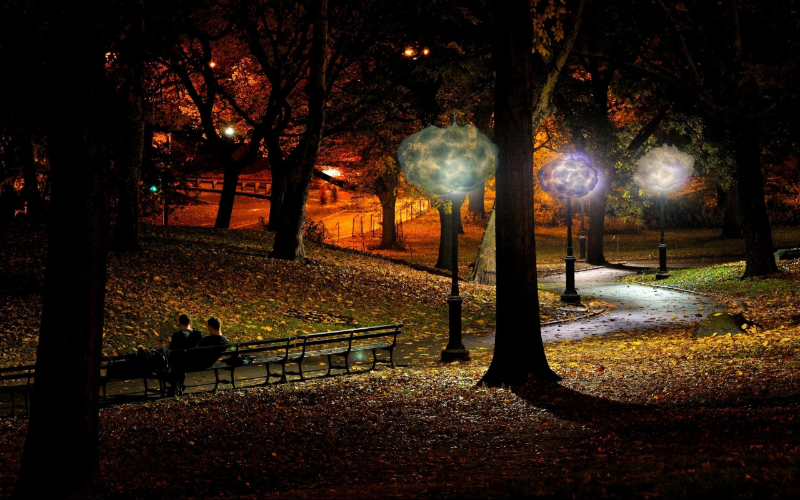

**Cloudy Night** is an interactive light installation that doubles as an anonymous sensor. A cloud-shaped lamp responds to people walking past it, and while doing so it logs infrared presence data that we analyzed to estimate park activity, direction of movement, and the presence of children.

We built the prototype and deployed it for three hours at **Starlight Park in the Bronx (May 4, 2019)**, in partnership with the **Bronx River Alliance**.

| **Context** | Urban Informatics II, Columbia University GSAPP (Spring 2019), advised by Dr. Anthony Vanky |
|---|---|
| **Team** | Shuyang Huang, Nick Kunz, Shiori Osakata |
| **Stack** | Arduino (C++), AK9753 4-channel IR presence sensor, WS2801 RGB LEDs, SD data logger + RTC, time-series analysis |
| **Outputs** | [Report (PDF)](reports/cloudynightreport.pdf) · [Presentation (PDF)](reports/cloudynightpresentation.pdf) · [Video](https://www.youtube.com/watch?v=UFdZAbp3dc4) |

## My Role

- Wrote the Arduino firmware for sensor reading, LED feedback, and SD/RTC data logging
- Designed the analysis of the IR data (directionality and child-presence metrics) and produced the plots
- Planned the field deployment with the Bronx River Alliance and ran data collection on site

## Research Questions

1. Can illuminating dimly lit park spaces with interactive lighting help people feel safer?
2. Can playful, illuminated interactivity increase park engagement?
3. Can a low-cost, privacy-preserving sensor detect patterns such as movement direction and the presence of children? Children's presence was used as a proxy for perceived safety.

## Concept

When someone comes within about 5 m of the cloud, the light inside changes color, which creates a visible feedback loop between people and the space.

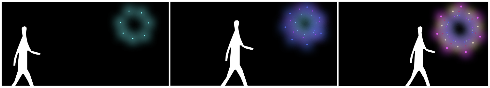
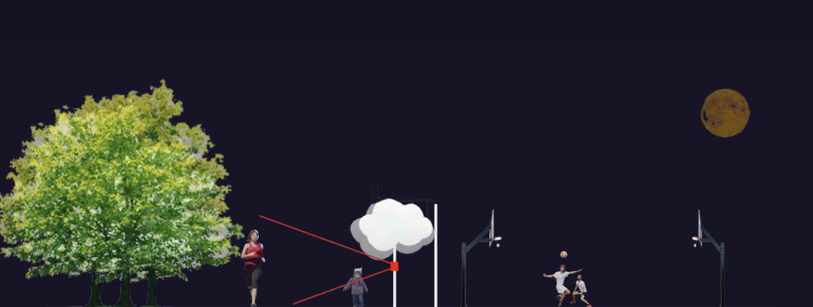

## How It Works

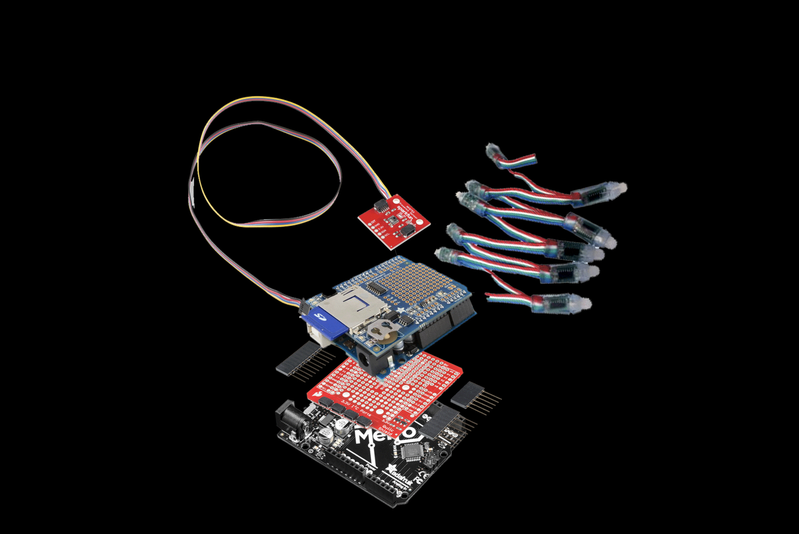

- **Sensing.** A SparkFun AK9753 human presence sensor has four IR channels facing up, left, down, and right. It records body heat without a camera, so **no identifiable data is collected**.
- **Feedback.** The firmware sums the four channels and maps the total to five lighting states. The idle state is a slow blue cycle. As more presence is detected, the lamp moves through progressively faster, multi-color wipes (thresholds of 1300, 2400, 3500, and 4500).
- **Logging.** Each reading is written to `cloudy1.csv` on an SD card with all four IR values, temperature, and an RTC timestamp.

Firmware: [`cloudynight.ino`](cloudynight.ino)

**Hardware:** Arduino Uno · SD Data Logger Shield · DS3231 RTC · SparkFun Qwiic Shield + cables · SparkFun AK9753 Human Presence Sensor · Adafruit 12 mm WS2801 RGB LED pixels (strand of 25)

| Sensor | Microcontroller stack | LEDs |
|---|---|---|
| 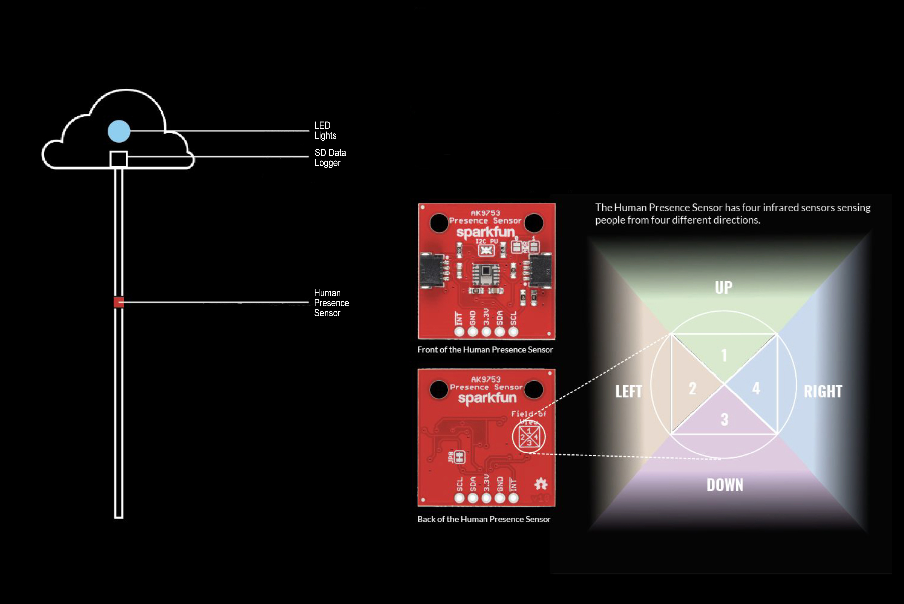 | 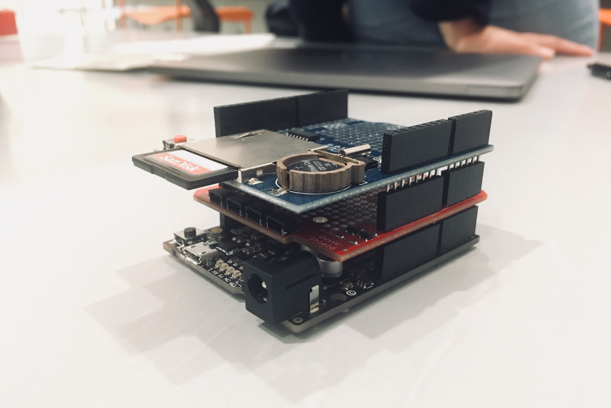 | 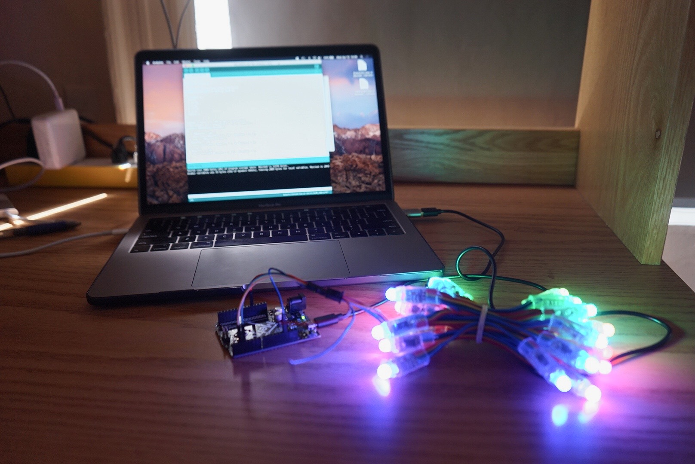 |

## Deployment

Starlight Park, Bronx, NY. May 4, 2019, 5:15–8:15 PM, at dusk on a shared pedestrian path next to a playground and sports courts.

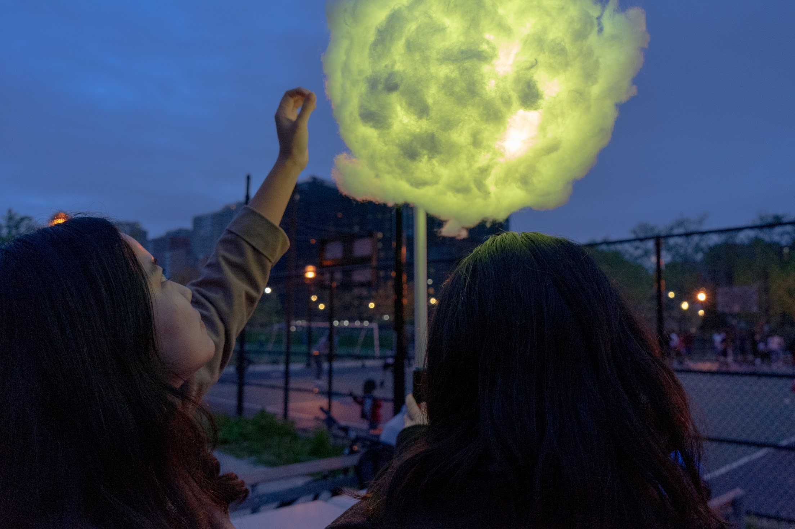

## Analysis & Findings

**1. Overall presence.** Averaging all four IR channels over the three-hour deployment shows general activity trends. All raw data is shown, including noise and outliers.

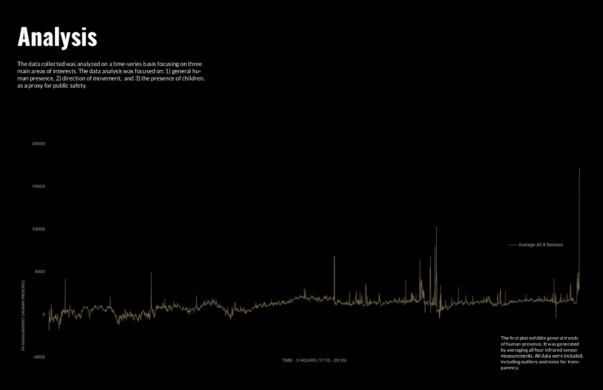

**2. Direction of movement.** Comparing the left (2) and right (4) channels approximates which side of the device people were on and how they moved past it. In the example window (17:30–17:35), people moved from right to left, perpendicular to the path.

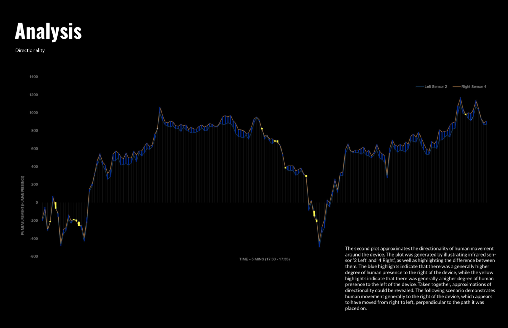

**3. Presence of children.** After normalizing the top (1) and bottom (3) channels, a stronger bottom-sensor signal suggests a shorter person nearby. Spikes in this metric (for example, around 18:20–18:23) were treated as likely child presence.

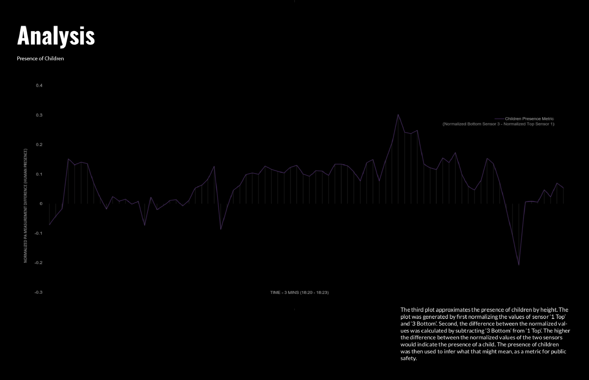

**Takeaway.** A single low-cost, camera-free sensor could roughly capture both movement direction and child presence. That makes it a plausible way to measure park use and perceived safety without collecting identifiable data.

## Limitations & Next Steps

This was a proof of concept, not a rigorous study:

- One device, one location, and one three-hour session, with **no control condition** (for example, the same spot with the light off).
- Event counts were not formally validated against ground truth, such as manual observation counts.
- Children's presence as a proxy for perceived safety is an assumption, not a measured outcome.
- Sensor range and accuracy are limited, and the lighting thresholds were set by hand.

Natural next steps would be multiple devices along a path, longer deployments, a light-on/light-off comparison, and calibrating the sensor metrics against manual counts.

## Acknowledgments

Built with Nick Kunz and Shiori Osakata for Urban Informatics II at Columbia GSAPP under Dr. Anthony Vanky. Thanks to the Bronx River Alliance. The LED driver code is adapted from Adafruit's WS2801 example (BSD license).
